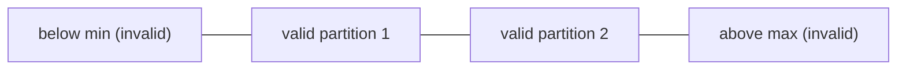
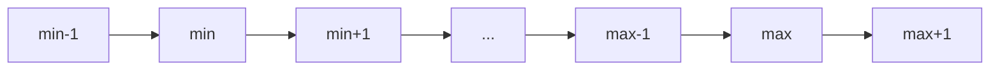
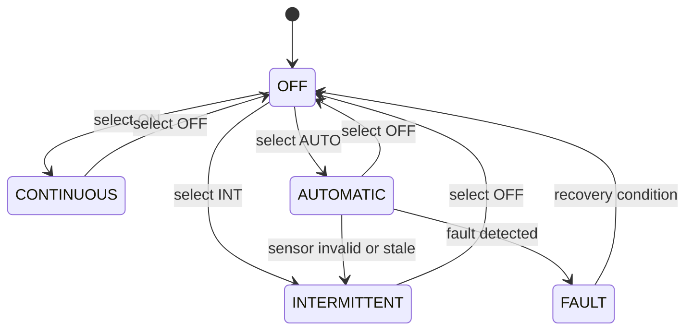
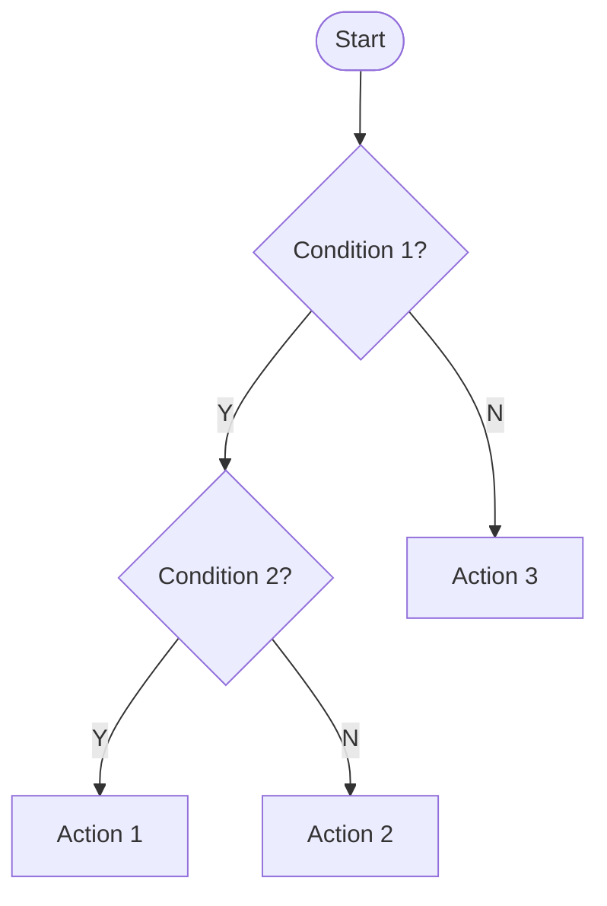
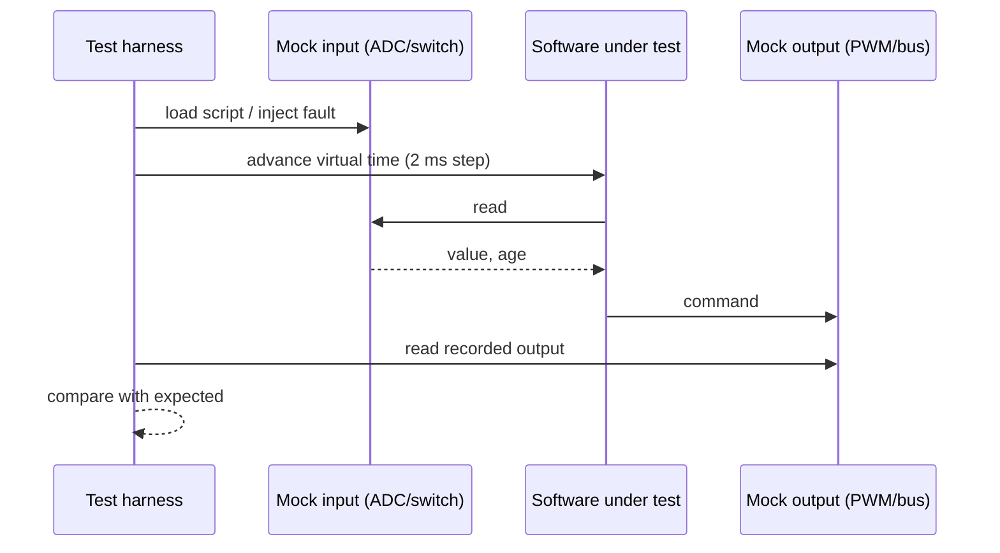
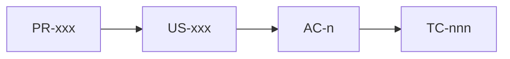
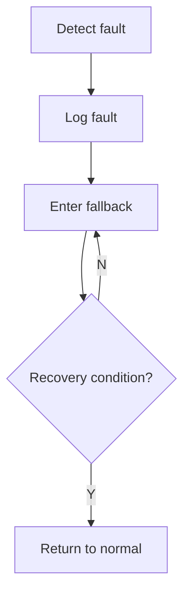

# Mermaid Snippets for Test Designs

## Partition line

## Boundary markers

## Mode state machine (wiper modes)

Adapt transitions to the actual story; this is a layout example, not a requirement.

## Decision flow

## Integration sequence with mocks

## Traceability

## Fault handling flow

