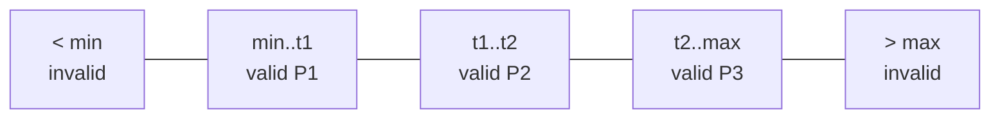
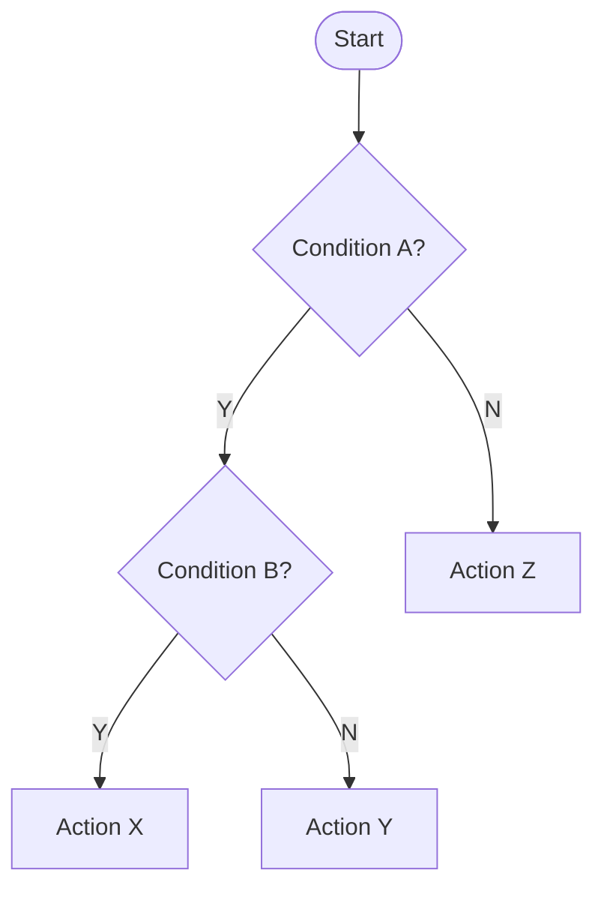
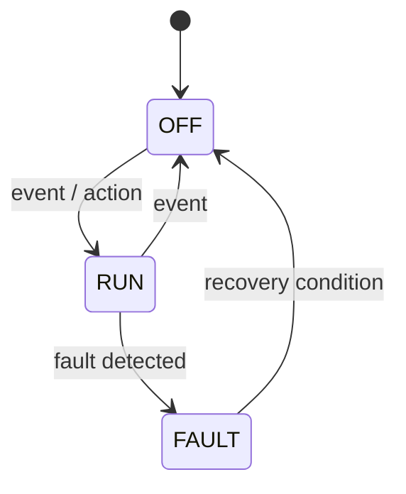
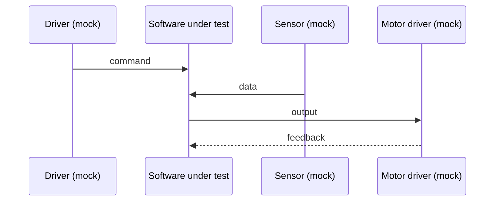

# ISTQB Technique Guide

Placeholders like `<min>` come from the requirement; never invent them.

## Equivalence Partitioning (EP)
1. List each input and its domain.
2. Split into valid partitions (behave identically) and invalid partitions (below, above, wrong type, stale, missing).
3. Coverage: each partition exercised at least once. Combine valid partitions of different inputs in one case; test each invalid partition in its own case.



| Partition | Range | Valid | Expected | Test |
|---|---|---|---|---|
| P0 | < min | N | rejected / fault | TC-xx |

## Boundary Value Analysis (BVA)
1. For each partition edge, take the boundary value and its neighbour in the adjacent partition (2-value BVA); add the value on the other side for 3-value BVA on safety-relevant limits.
2. Use the smallest resolution of the signal (ADC LSB, ms tick, 2 ms control cycle) as the step.
3. Include timing boundaries (e.g. stale threshold: just below / at / just above).

```text
 invalid | valid ........................ | invalid
   min-1 | min  min+1 ... max-1  max       | max+1
```

## Decision Table
1. List conditions (inputs) and actions (outputs).
2. Enumerate rules (2^n for n boolean conditions); collapse with "don't care" (-) where the outcome is identical.
3. Coverage: each rule exercised once.

| Rule | R1 | R2 | R3 |
|---|---|---|---|
| Cond A | Y | Y | N |
| Cond B | Y | N | - |
| Action | X | Y | Z |



## State Transition
1. Identify states, events/guards, actions.
2. Draw the diagram; build the state x event table, marking invalid cells.
3. Coverage levels: all states -> all valid transitions (default) -> invalid transitions (for safety/fault behaviour) -> N-switch sequences where requirement demands (e.g. hysteresis, fault then recovery).



| State \ Event | E1 | E2 | E3 |
|---|---|---|---|
| OFF | RUN | - (ignored) | - |
| RUN | - | OFF | FAULT |

## Pairwise (All-Pairs)
1. List parameters and values (e.g. motor variant S/M/L, mode OFF/INT/AUTO/ON, sensor valid/stale/invalid).
2. Generate a covering array so every value pair of any two parameters appears at least once.
3. Add constraints (invalid combinations) and add single-fault cases separately.
4. Report: full combinations N -> pairwise set M; show a pair-coverage statement.

For parameters with counts k1, k2, ... the lower bound on the number of cases is k1 x k2 for the two largest parameters.

## Use-Case / Flow
1. One main flow plus alternative/exception flows, each with precondition, steps, postcondition.
2. Coverage: main flow and every alternative flow once.



## Choosing and combining
- Start EP, then BVA on numeric partitions.
- Add State Transition when behaviour depends on history (modes, hysteresis, faults).
- Add Decision Table for priority/arbitration rules.
- Add Pairwise for configuration matrices; keep fault cases as separate single-fault tests.
- Add Use-Case for end-to-end and recovery scenarios at system level.

## Minimisation heuristics
- Merge valid-partition cases across independent inputs.
- One invalid input per negative case (avoid fault masking).
- Reuse a case for several boundaries only if all expected results are checked.
- Record which partitions/pairs/transitions each case covers.
