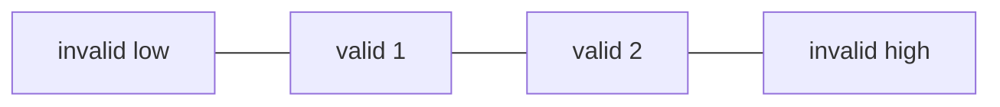
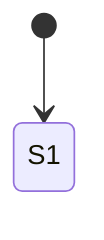
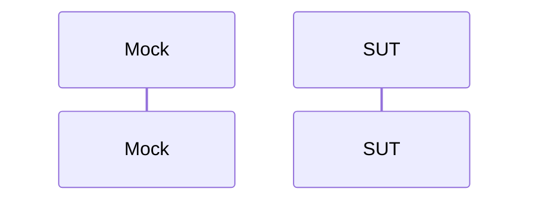

# Test Design: <ID> - <Title>

| Field | Value |
|---|---|
| Requirement / Story | <US-xxx / PR-xxx> |
| Source | <path to story or PRD section> |
| Test level | System / Integration |
| Date | <YYYY-MM-DD> |
| Status | Designed (not executed) |

## 1. Scope
- In scope: <behaviour covered>
- Out of scope: <excluded and why>

## 2. Analysis
| Item | Detail |
|---|---|
| Inputs | <name, type, range, unit, rate> |
| Outputs | <name, type, range> |
| States | <list> |
| Timing | <periods, thresholds> |
| Acceptance criteria | <AC-1 ... AC-n> |

## 3. External Dependencies and Mocks
| Dependency | Interface | Mock behaviour | Injected | Observed | Faults |
|---|---|---|---|---|---|

## 4. Technique Selection
| Technique | Applied | Rationale |
|---|---|---|
| EP | Y/N | |
| BVA | Y/N | |
| Decision Table | Y/N | |
| State Transition | Y/N | |
| Pairwise | Y/N | |
| Use-Case | Y/N | |

## 5. Test Design

### 5.1 Equivalence Partitioning

| Partition | Range | Valid | Test |
|---|---|---|---|

### 5.2 Boundary Value Analysis
```text
 <ASCII boundary line>
```
| Boundary | Below | On | Above | Test |
|---|---|---|---|---|

### 5.3 Decision Table
| Rule | R1 | R2 |
|---|---|---|

### 5.4 State Transition

| State \ Event | E1 | E2 |
|---|---|---|

### 5.5 Pairwise
| Parameter | Values |
|---|---|
Full combinations: <N>; pairwise set: <M>.

### 5.6 Use-Case / Flow


## 6. Minimum Test Specification
| ID | Level | Technique | Trace | Mocks / initial state | Inputs (with virtual time) | Expected result | Covers |
|---|---|---|---|---|---|---|---|
| TC-001 | System | EP | <US/PR> | | | | P1 |

## 7. Coverage and Traceability
| Requirement / AC | Test cases |
|---|---|

| Technique | Items | Covered | % |
|---|---|---|---|

## 8. Assumptions and Open Questions
- TBD: <question>
